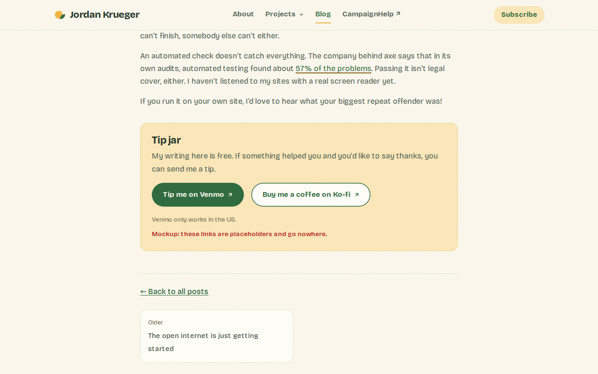
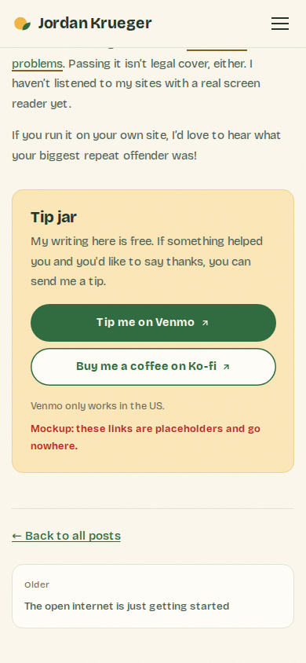
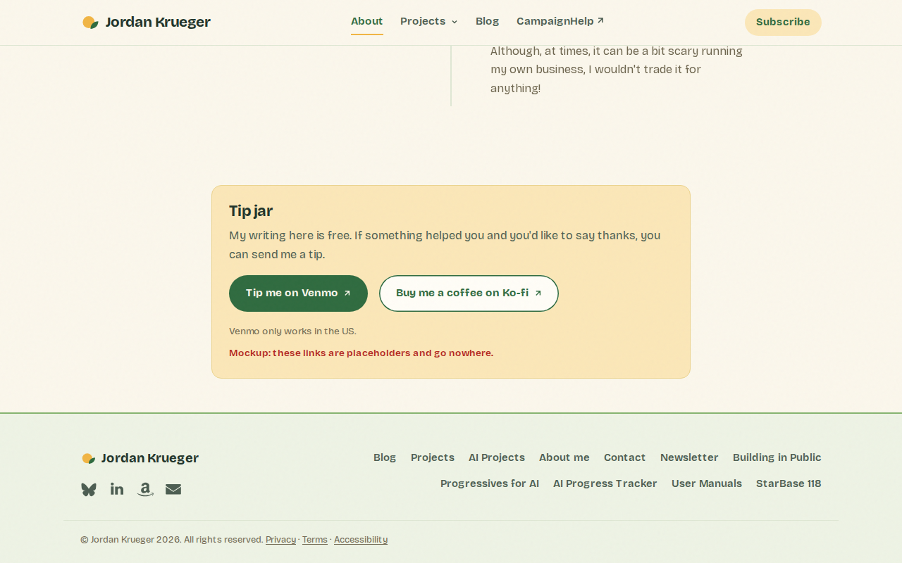
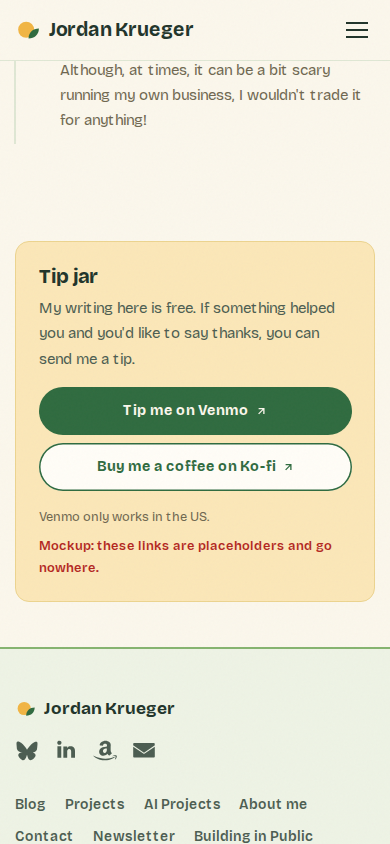
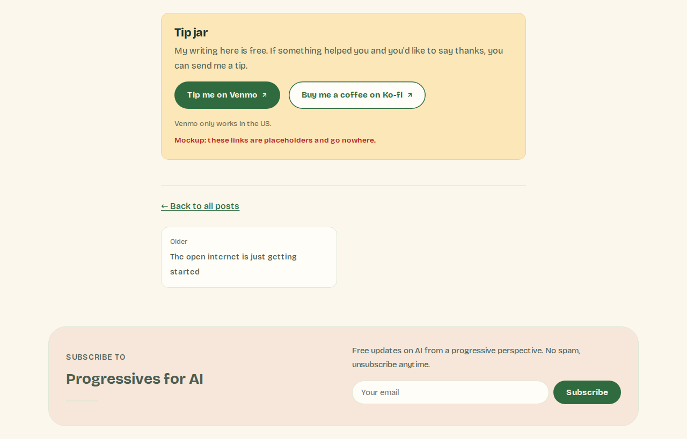
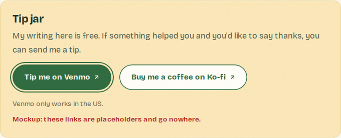

# Tip jar for jordankrueger.com

Research and mockup, 2026-11-28. Branch `tip-jar`. Nothing is merged, pushed or deployed, and no accounts were created.

## Decisions Jordan needs to make

1. **Which service.**
   - **A. A direct Venmo link plus a Ko-fi page (recommended, and what the mockup shows).** Two plain links.
   - **B. Ko-fi only.** One button. Third-party sites say Ko-fi takes Venmo through PayPal, so this may be all you need. I could not confirm that on Ko-fi's own pages, so check it first.
   - **C. A direct Venmo link plus Buy Me a Coffee.** Choose this only if you want that brand. It costs more per tip.
2. **Your Venmo link, and which kind of profile.** Send the link copied from the app. A personal profile is free to receive on, but Venmo limits business use of personal profiles, and nothing I read says how it treats a thank-you tip. A business profile costs 1.9% + 10¢ and is the cautious choice. Details are under [Venmo rules](#venmo-rules-to-know-first).
3. **Your coffee page URL.** You would need to create the Ko-fi (or Buy Me a Coffee) page yourself.
4. **Where on the site.** The mockup puts the box in two places: the end of every blog post (35 posts today) and the bottom of the About page. You can keep both, keep one, or use a small footer link instead.
5. **Wording.** Approve or change the text under [Copy](#copy).

## Short answers

- **Does Buy Me a Coffee take Venmo?** I found no sign that it does. Its [help center FAQ](https://help.buymeacoffee.com/en/articles/4539170-frequently-asked-questions) says "We accept all major Credit Cards, Apple Pay, and Google Pay." Venmo appeared on none of the help pages I read. Its main-site FAQ and pricing pages refused automated fetches, so I did not read those.
- **Does any coffee-style widget take Venmo?** Ko-fi's page does, through a connected PayPal account, for US supporters, according to [Best Creator Platforms](https://bestcreatorplatforms.com/reviews/ko-fi/) and [Owelet](https://owelet.app/blog/ko-fi-payout-schedule) (Owelet does not mention the US limit). Both are third-party sites.
- **Do we need a third-party script?** No. Plain links do the job. The security policy (CSP) stays as it is.

## Recommendation

Use **two plain links: "Tip me on Venmo" and "Buy me a coffee on Ko-fi."** No widget, no script, no embed.

Why a direct Venmo link and not only Ko-fi:

- It is certain to be Venmo. Ko-fi's Venmo option depends on a PayPal connection, and [Owelet says](https://owelet.app/blog/ko-fi-payout-schedule) Ko-fi picks which payment options to show based on the supporter's device and location.
- It costs less: free on a personal profile, or 1.9% + 10¢ on a business profile ([Venmo fees](https://venmo.com/resources/our-fees/)).

Why Ko-fi and not Buy Me a Coffee:

- Buy Me a Coffee takes a [5% platform fee plus card processing](https://help.buymeacoffee.com/en/articles/8105744-how-to-calculate-charges-on-your-payment).
- Ko-fi takes 0% on one-time tips **if you turn off its "Standard" setting** (one source calls it "Contributor"). New accounts start with it on, which means 5% ([Lilach Bullock](https://www.lilachbullock.com/how-much-does-ko-fi-take/), [Best Creator Platforms](https://bestcreatorplatforms.com/reviews/ko-fi/), [Owelet](https://owelet.app/blog/ko-fi-payout-schedule); all third party).

Why plain links and not a widget:

- A link works with a keyboard and a screen reader without any extra work.
- No new script, no CSP change, no new cookie.
- I read [Buy Me a Coffee's floating widget script](https://cdnjs.buymeacoffee.com/1.0.0/widget.prod.min.js). Its button is a `div` with mouse and click handlers. It sets no `tabindex`, `role` or `aria` attribute and has no key handlers, so as written a keyboard user cannot reach or open it. I read the code; I did not run it.

**When to pick B instead:** if you open your finished Ko-fi page on a US phone, see Venmo offered, and would rather have one button. Set `VENMO_URL` to `''` and the Venmo button and its note disappear.

## Comparison

### Money

"Left from $5" is my arithmetic from the linked rates, for a one-time US tip, before any bank transfer fee.

| Option | Venmo from supporters? | Fees | Left from $5 | How you get paid |
|---|---|---|---|---|
| Buy Me a Coffee | Not found | [5% + Stripe 2.9% + 30¢](https://help.buymeacoffee.com/en/articles/8105744-how-to-calculate-charges-on-your-payment); +1% outside the US. The same page also mentions a 0.5% payout processing fee | about $4.30 | [Stripe, then your bank](https://help.buymeacoffee.com/en/articles/6364717-when-are-payouts-processed). $10 minimum; first payout is reviewed |
| Ko-fi | [Yes, via PayPal, US](https://bestcreatorplatforms.com/reviews/ko-fi/) (third party) | [0% on one-time tips with "Standard" off](https://www.lilachbullock.com/how-much-does-ko-fi-take/), plus processor fees of about 3% + 30¢ (third party) | about $4.55 | [Straight into your PayPal or Stripe](https://owelet.app/blog/ko-fi-payout-schedule) (third party) |
| PayPal Donate button | [Seen on 9 of 9 nonprofit donate pages](https://connectnpo.com/venmo-for-nonprofits/) (third party); not confirmed for individuals | [2.89% + 49¢](https://www.paypalobjects.com/marketing/ua/pdf/US/US-paypal-fees-19-feb-2026.pdf) | about $4.37 | PayPal balance; [standard bank withdrawal is free](https://www.paypalobjects.com/marketing/ua/pdf/US/US-paypal-fees-19-feb-2026.pdf) |
| PayPal.me link | Not found | [Friends and family: free to receive](https://www.paypalobjects.com/marketing/ua/pdf/US/US-paypal-fees-19-feb-2026.pdf), but that category excludes donations and commercial payments | depends on how the payment is classed | PayPal balance |
| Stripe Payment Link | Not found. [Not among the listed methods](https://docs.stripe.com/payments/payment-methods/payment-method-support) in the part I read | [2.9% + 30¢](https://stripe.com/pricing) | about $4.55 | [Your bank](https://docs.stripe.com/payouts); first payout typically 7–14 days |
| Venmo link or QR, personal profile | Yes | [Free](https://venmo.com/resources/our-fees/); 2.99% if the sender marks it goods and services | $5.00 (about $4.85 if marked) | Venmo balance; [standard transfer free, instant 1.75%](https://venmo.com/resources/our-fees/) |
| Venmo link or QR, business profile | Yes | [1.9% + 10¢](https://venmo.com/resources/our-fees/) | about $4.80 | Same as above |

Notes:

- Buy Me a Coffee lets you choose whether [you or the supporter covers the card fee](https://help.buymeacoffee.com/en/articles/8105320-how-to-eliminate-the-credit-card-fee-from-your-earnings). By default it comes out of your earnings.
- The PayPal fee file is dated February 19, 2026. PayPal's web fee pages refused automated fetches, so check for a newer one.
- A [competitor's guide](https://www.zeffy.com/blog/paypal-donate-button) says a Donate button needs a PayPal Business account. PayPal's [Donate developer page](https://developer.paypal.com/sdk/donate/) sends you to your account to check eligibility.
- Stripe allows tips only [for a good or service already provided](https://support.stripe.com/questions/requirements-for-accepting-tips-or-donations), such as content. It does let [customers choose the amount](https://docs.stripe.com/payment-links).
- PayPal's [Pay with Venmo](https://developer.paypal.com/docs/checkout/pay-with-venmo/) button is for a checkout built with PayPal's JavaScript, US only, and needs the Venmo app. It is more than a tip jar needs.

### Your website

| Option | Plain link works? | Third-party script if you embed | CSP change if you embed | Widget accessibility |
|---|---|---|---|---|
| Buy Me a Coffee | [Yes](https://help.buymeacoffee.com/en/articles/7983531-ways-to-support-creators) | [`cdnjs.buymeacoffee.com` widget](https://cdnjs.buymeacoffee.com/1.0.0/widget.prod.min.js) | `script-src` cdnjs.buymeacoffee.com; `img-src` and `font-src` cdn.buymeacoffee.com; `frame-src` www.buymeacoffee.com (read from the script) | No statement found. Floating button is not keyboard operable in the script I read |
| Ko-fi | Yes ([your page has its own address](https://bestcreatorplatforms.com/reviews/ko-fi/)) | The floating widget uses two script tags, including `overlay-widget.js`, per a [third-party wrapper project](https://github.com/liddiard/react-kofi-overlay). Script address not checked | Not checked; it would need Ko-fi script and frame sources | Not checked |
| PayPal | [PayPal.me is a shareable link](https://www.paypal.com/paypalme/) | [`paypalobjects.com/donate/sdk/donate-sdk.js`](https://developer.paypal.com/sdk/donate/) for the SDK button | At least `script-src` www.paypalobjects.com; full list not checked | No statement found |
| Stripe | [Yes](https://docs.stripe.com/payment-links) | [`js.stripe.com/v3/buy-button.js`](https://docs.stripe.com/payment-links/buy-button) | [`script-src` and `frame-src` js.stripe.com](https://docs.stripe.com/payment-links/buy-button) | No statement found |
| Venmo | Yes, a link or a [QR image from the app](https://help.venmo.com/cs/articles/personal-qr-codes-on-venmo-faq-vhel316) | None | None | A link is native; a QR image would need alt text and the link beside it |

With a plain link, the visitor's data goes to the service only after they click. A widget or embed loads from the service on every page that carries it, so the privacy page would need to say so. The Buy Me a Coffee script also sets a `visited` cookie.

## Venmo rules to know first

- Venmo is [US only and needs a US bank account](https://venmo.com/legal/us-user-agreement/). That is why the second link matters: it covers people who pay by card.
- The [user agreement](https://venmo.com/legal/us-user-agreement/) says personal accounts "may not be used to conduct business, commercial or merchant transactions" unless Venmo authorizes it, for example when the sender marks the payment as goods and services.
- Venmo's [help center](https://help.venmo.com/cs/articles/can-i-use-venmo-to-buy-or-sell-merchandise-goods-or-services-vhel227) says: "Personal profiles should not be used to receive funds for user-created donation campaigns or non-profits." So the copy never says "donate".
- **Nothing I read says whether a thank-you tip for free writing counts as a personal payment or a commercial one.** That is your call, or a question for Venmo support.
- A business profile [works for individuals and sole proprietors](https://help.venmo.com/cs/articles/business-profiles-faq-vhel143), can use your [SSN or ITIN if you have no EIN](https://help.venmo.com/cs/articles/how-to-sign-up-for-a-business-profile-vhel163), and is [subject to fees and tax reporting](https://help.venmo.com/cs/articles/business-profiles-faq-vhel143). It also has an [optional tipping setting](https://help.venmo.com/cs/articles/business-profiles-basic-functions-vhel280). I did not research taxes beyond this.
- Venmo's [default privacy setting is public](https://venmo.com/legal/us-helpful-information). Check yours.

## Where it fits on the site

| Place | File | In the mockup | Notes |
|---|---|---|---|
| End of each blog post | `src/layouts/BlogPost.astro`, after the bottom discussion bar | Yes | Reaches people who just got something from you. The newsletter box still follows lower down, so there are two asks. RSS is unaffected because `src/pages/rss.xml.js` renders only the post body |
| Bottom of About | `src/pages/about.astro`, after the timeline | Yes | Quieter. It sits below a long timeline |
| Footer link | `src/components/Footer.astro`, `.footer-links` | No | Every page, very low-key. Would need a target such as `/about#support`, which means adding that id |
| Homepage | `src/pages/index.astro` | No | Not recommended. The page sells your two practices and the book |

The blog box has no per-post off switch. If some posts should not ask for tips, that needs a frontmatter field like the existing `hideNewsletter`.

## What changes: CSP and privacy page

**CSP (`public/_headers`): no change.** The current policy limits what the page loads; it does not limit where links go. The site's `Referrer-Policy` of `strict-origin-when-cross-origin` means Venmo or Ko-fi see only that the visitor came from your domain, not which page.

**Privacy page (`src/pages/privacy.astro`): edited on the branch**, for you to approve.

1. New bullet under "What I collect": "**Tips.** The tip links take you to Venmo or Ko-fi. You pay there, not on this site, and their privacy policies apply. I can see what they pass along to me about your tip, such as your name and any note you write."
2. "The short version" now reads: "...and I only get personal details you choose to send, like through the newsletter box, the contact form, or a tip."
3. "Last updated" is now November 28, 2026. Change it to the day you publish.

**Terms page:** not changed. Add a line about tips only if you want one.

**Separate gap I noticed, not fixed:** the privacy page does not mention the postcard form on `/2076`, although `functions/api/postcards.js` stores the name, place and answers that people send. Its line about nothing sitting in a database "beyond a newsletter email or a message you sent me" does not clearly cover postcards.

## Copy

> **Tip jar** (heading)
>
> My writing here is free. If something helped you and you'd like to say thanks, you can send me a tip.
>
> [Tip me on Venmo] [Buy me a coffee on Ko-fi]
>
> Venmo only works in the US.

The `humanizer` skill was not installed on the machine that ran this, so I edited the copy by hand. Run it before publishing if you want that pass.

## Screenshots

Taken from the production build with all outside requests blocked, so the newsletter's bot check does not appear. The red "Mockup" line shows only while a link is a placeholder.

### End of a blog post, desktop (1280 px wide)

### End of a blog post, phone (390 px wide)

### Bottom of About, desktop

### Bottom of About, phone

### How the tip box and newsletter box stack on a post

### Keyboard focus

## What was checked

- `npm run build` succeeded. The box appears on 35 blog post pages and on About, and not in `rss.xml`.
- `node scripts/check-contrast.mjs` passed.
- In headless Chromium on both pages at both widths: no sideways scrolling; Tab reaches the Venmo link, then the Ko-fi link, each with a 2 px focus outline; both links are 48 px tall or more.
- An axe scan limited to the tip box reported no violations.
- Not done: listening with a real screen reader, testing on a real phone, and any test of a real Venmo or Ko-fi link.

## Before it can go live

1. Create the accounts you chose. For Ko-fi: connect PayPal (needed for Venmo) and turn off "Standard".
2. In `src/components/SupportLinks.astro`, replace the two placeholders:
   - `VENMO_URL`: `https://example.invalid/YOUR-VENMO-PROFILE-LINK`
   - `KOFI_URL`: `https://example.invalid/YOUR-KOFI-PAGE`
3. Copy the Venmo link from the app rather than typing it. A [third-party guide](https://www.einsstark.tech/share-venmo-profile-link/) gives the path as profile picture, "Share Profile", then the copy icon.
4. Open both links on a phone and on a computer. I could not find out from Venmo what a computer visitor sees. If it is not useful, add your Venmo QR image next to the button.
5. If you choose Buy Me a Coffee, change the second button's label in the component and "Ko-fi" in the privacy bullet.

Do not merge the branch while either placeholder remains. Placeholder links go nowhere (`.invalid` is a reserved domain), so no money can reach a stranger by mistake.

## What I could not verify

- **Ko-fi's own pages** returned "403 Forbidden" to automated fetches, so every Ko-fi claim here comes from third parties. Open these yourself before deciding: [payment methods](https://help.ko-fi.com/hc/en-us/articles/24482435253661-What-payment-methods-are-available-on-Ko-fi) and [pricing](https://ko-fi.com/pricing). I have not read either.
- Whether Ko-fi needs a PayPal Business account to offer Venmo.
- Whether PayPal.me offers Venmo to the person paying.
- Whether a tip on a personal Venmo profile is allowed.
- The Venmo link format and what it does on a computer.
